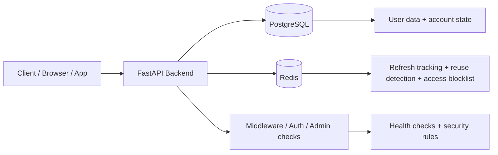
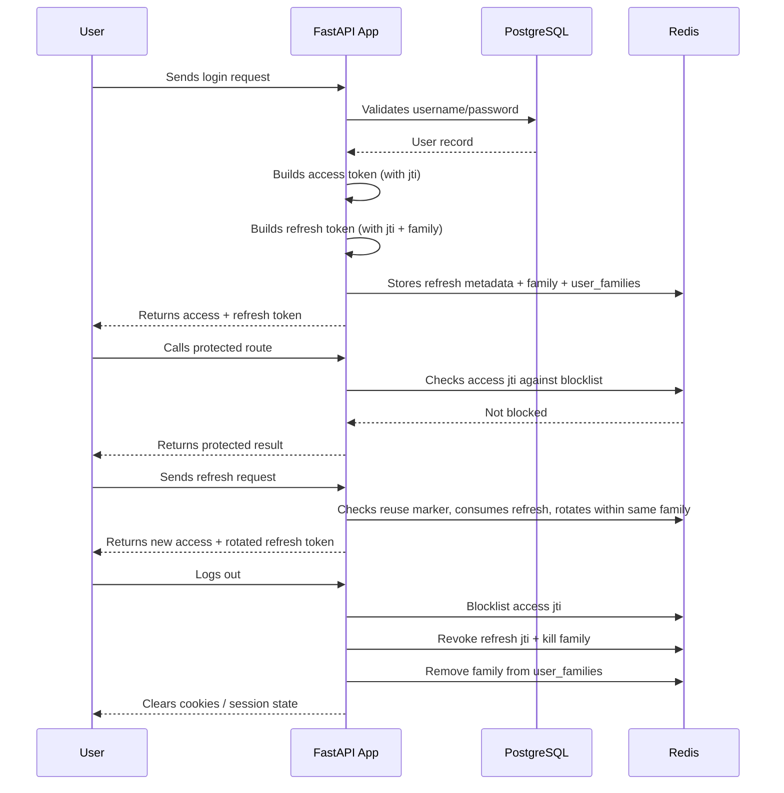

# API Boilerplate
# 🔐 VeriFlow Backend API (`jwt_api`)

<div align="center">
  
  
  
  
  
  
  
  
  
</div>

A clean FastAPI starter for login, user auth, Redis-backed refresh handling, and admin access control.
<p align="center">
  <strong>Enterprise-Grade Asymmetric (RS256) Cryptographic Key Authority, Offline-First QR Verification, Work Shift Session Manager, and Granular RBAC Backend built with FastAPI, PostgreSQL, and Redis.</strong>
</p>

## Problem this solves
---

Most API boilerplates are either:
## 🌟 Overview

- too simple and leave out real auth, refresh flow, and session tracking
- too complex and feel like a research project instead of an app starter
- missing the operational basics: env config, health checks, Redis handling, and admin access control
**VeriFlow API (`jwt_api`)** powers both the **VeriFlow React Web Console** (`Frontend/veriflow`) and the **VeriFlow Offline-First Android Scanner App** (`app/veriflow`).

This project is built to solve the real gap between "hello world API" and "production-ready starter".
Unlike traditional cloud-tethered inventory systems that fail in warehouse dead-zones, VeriFlow acts as an **Asymmetric Cryptographic Key Authority**:
1. **RSA-2048 / RSA-4096 Keypairs** are generated in RAM; private keys are encrypted at rest using **AES-256-GCM** (`ENCRYPTION_KEY`) and decrypted only in volatile memory during signing.
2. **Product Tag QR Codes**, **Work Shift Tokens**, and **RS256 Access Tokens** are cryptographically signed with **RS256** and support custom expiration durations in **seconds, minutes, hours, days, weeks, months, or years**.
3. **Active Inventory Rules** and **Granular User Permissions** are embedded directly into signed JWT claims, allowing mobile scanners to verify tags **100% offline** in `< 5ms` using cached RSA public keys (JWKS) and synchronize audit logs later via idempotent batch ingestion.

It gives you a working backend shape for:
---

- secure login and signup
- short-lived access tokens + refresh token rotation
- Redis-based refresh tracking and reuse protection
- server-side access token blocklisting (immediate logout)
- server-side logout-everywhere (revoke all sessions for a user)
- admin-role checks
- structured startup, config, and health monitoring
## 🏗️ System Architecture

### Why this is different from other boilerplates
```mermaid
flowchart LR
    subgraph Clients["Clients"]
        W["VeriFlow React Web Console"]
        M["VeriFlow Android Scanner (SQLite Offline)"]
    end

Other boilerplates often stop at a basic CRUD API and ignore the most painful parts of real product auth.
    subgraph API["FastAPI Backend (jwt_api)"]
        MW["CORS (.env) + Rate Limit + KillSwitch + GZip"]
        AUTH["Auth + MFA (TOTP / Email OTP) + RBAC"]
        KEYS["RS256 Key Authority (AES-256-GCM)"]
        SHIFTS["Shift & Session Engine"]
        RULES["Inventory Rules Engine"]
        SCANS["Idempotent Batch Scan Sync"]
    end

This one is designed for the boring but important stuff that usually breaks in production:
    subgraph Storage["Persistence & Cache"]
        PG[("PostgreSQL (Async SQLAlchemy)")]
        RD[("Redis (Token Families, Blocklist, Active Shift TTL)")]
    end

- login works without custom glue code
- refresh tokens rotate safely
- access tokens can be revoked immediately on logout (not just waited out until expiry)
- every refresh token in a session family dies together — reuse detection actually propagates
- user sessions can be invalidated server-side, per-session or across all devices
- admin access is defined cleanly
- local development is easy to run with fake but realistic config
    W --> MW
    M --> MW
    MW --> AUTH
    AUTH --> KEYS & SHIFTS & RULES & SCANS
    KEYS & SHIFTS & RULES & SCANS --> PG
    AUTH & SHIFTS --> RD
```

### Cryptographic Shift & Offline Verification Lifecycle


sequenceDiagram
    participant Admin as Web Console (Admin / Operator)
    participant API as VeriFlow FastAPI
    participant DB as PostgreSQL + Redis
    participant Scanner as Android Scanner (Offline SQLite)

### Token lifecycle
    Admin->>API: 1. Generate RSA Keypair & Inventory Rules
    API->>DB: Encrypt Private Key (AES-256-GCM) & Store Public PEM + Rules
    Admin->>API: 2. Generate Product Tag QR (POST /app/v1/keys/tags/qr)
    API-->>Admin: RS256-Signed Product QR Code (Custom Expiry: Sec/Min/Hr/Day/Wk/Mo/Yr)

```mermaid
flowchart TD
    A[Login Request] --> B[Validate User]
    B --> C[Create Access Token with jti]
    B --> D[Create Refresh Token with jti + family]
    C --> E[Protected API Call]
    D --> F[Store in Redis: refresh + family + user_families]
    E --> G{jti in blocklist?}
    G -->|Yes| I[Reject Request]
    G -->|No| G2{Token valid?}
    G2 -->|Yes| H[Allow Request]
    G2 -->|No| I
    H --> J[Refresh When Needed]
    J --> K[Rotate Refresh Token - same family]
    K --> L[Issue New Access Token]
    F --> M[Logout / Revoke Session]
    M --> N[Blocklist access jti + kill refresh family]
    M --> O[Logout-Everywhere: kill all user families]
    Admin->>API: 3. Start Work Shift (POST /app/v1/shifts/start)
    API->>DB: Lock Active Shift in Redis (TTL = Custom Duration) + Persist Shift
    API-->>Scanner: Scannable Shift Token QR (Embeds kid, Rules & Permissions)

    Note over Scanner: Offline Warehouse Floor (Zero Network Needed)
    Scanner->>Scanner: 4. Verify Product QR Signature with Public Key + Evaluate Embedded Rules
    Scanner->>Scanner: 5. Store Audit Log in Local SQLite (Idempotent scan_id UUID)

    Note over Scanner,API: Network Restored
    Scanner->>API: 6. Batch Upload Scans (POST /app/v1/scans/sync)
    API->>DB: Deduplicate scan_id (ON CONFLICT DO NOTHING) & Update Analytics
    API-->>Scanner: Sync Summary (Accepted / Duplicate Counts)
```

---

## Quick overview
## ✨ Key Capabilities

```text
Client App
    |
    v
FastAPI API
    |
    +--> PostgreSQL (users / account data)
    |
    +--> Redis (refresh token tracking + access token blocklist)
```
### 1. 🔑 Asymmetric Cryptographic Key Authority (`/app/v1/keys`)
- **RSA-2048 & RSA-4096 Generation**: Private keys are encrypted with **AES-256-GCM** before touching PostgreSQL.
- **Zero-Downtime Key Rotation & Revocation**: Rotate active signing keys or revoke compromised keys with mandatory audit reasons.
- **Step-Up Authenticated Private Key Export**: Exporting a decrypted private key (`POST /app/v1/keys/{key_id}/export-private`) requires Admin role + account password verification + live **MFA OTP** (TOTP or Email OTP) if MFA is enabled on the account.
- **Ownership-Scoped Key Deletion (`DELETE /app/v1/keys/{key_id}`)**:
  - **Admins / `keys.delete.any`**: Can delete any cryptographic key (with optional `force=true` cascade cleanup of associated shifts and scan logs).
  - **Normal Users with `keys.delete`**: Can only delete keys they created for themselves (`created_by == user_id` and `issued_by == user_id`), never keys issued by an Admin or another user.
- **JWKS Endpoint (`GET /app/v1/keys/jwks.json`)**: Standards-compliant public key distribution for offline scanners.

### Included features
### 2. ⏱️ Custom Token & Shift Expiration (Seconds → Years)
All token and QR issuance endpoints support custom numerical duration values alongside flexible time units (`seconds`, `minutes`, `hours`, `days`, `weeks`, `months`, `years`):
- **Start Work Shift (`POST /app/v1/shifts/start`)**: Accepts `duration_value` + `duration_unit` (`seconds` | `minutes` | `hours` | `days` | `weeks` | `months` | `years`), plus backward-compatible `duration_hours`. Sets both the JWT `exp` claim and the Redis active-shift lock TTL to the exact duration in seconds.
- **Issue RS256 Access Token (`POST /app/v1/keys/tokens/issue`)**: Accepts `expires_in_value` + `expires_in_unit` (`seconds` → `years`) or legacy `expires_in_minutes`.
- **Generate Product Tag QR (`POST /app/v1/keys/tags/qr`)**: Accepts `expires_in_value` + `expires_in_unit` (`seconds` → `years`) and renders auto-versioned QR codes (`json` base64 Data URL or direct `image/png` stream via `qr_only=true`).

- JWT access tokens (with `jti`) + refresh tokens (with `jti` + `family`)
- Redis-based refresh storage, rotation, and reuse detection
- Access token blocklisting — logout kills the access token immediately
- Family-level refresh revocation — one reuse kills the whole session lineage
- Logout-everywhere — revoke every refresh family for a user
- Cookie auth support
- Admin access checks
- Rate limiting and kill-switch middleware
- Health checks and structured logging
### 3. 👷 Work Shifts & Scanner Sessions (`/app/v1/shifts`)
- **Scoped Shift Tokens**: Mints RS256 `shift_token` JWTs containing operator identity, `shift_id`, `device_id`, `kid`, user permissions, and optionally active inventory rules (`include_rules=true`).
- **Direct On-Screen QR Rendering**: Pass `?qr_only=true` on shift start or reissue to stream `image/png` directly.
- **Ownership-Scoped Shift Deletion (`DELETE /app/v1/shifts/{shift_id}`)**:
  - **Admins / `shifts.delete.any`**: Can delete any user's shift by valid `shift_id` (clearing Redis active locks and cascading shift scan logs).
  - **Normal Users with `shifts.delete`**: Can only delete shifts they started for themselves (`user_id == current_user` and `created_by == current_user`), not shifts created for them by an Admin.

### 4. 📋 Dynamic Inventory Rules Engine (`/app/v1/rules`)
- Define claim-matching validation rules (`matching_claim_key`, `expected_value`, `operator`, `severity`) scoped globally, to a specific cryptographic key (`key_id`), or assigned to a specific user (`target_user_id`).
- Rules are automatically embedded into shift tokens and RS256 tokens signed with the corresponding key.

### 5. 📱 Offline Batch Scan Sync & Mobile Data Controls (`/app/v1/scans`)
- **Idempotent Batch Ingestion (`POST /app/v1/scans/sync`)**: Accepts up to 500 offline scan records per batch with `ON CONFLICT (scan_id) DO NOTHING` deduplication.
- **Mobile SQLite Wipe Permission (`user.delete_all_data`)**: Dedicated RBAC permission embedded in user/shift tokens that authorizes the Android scanner app to wipe all local SQLite tables (`scan_history`, `public_keys`, `validation_rules`, `shifts`, `offline_users`).

### 6. 🛡️ Authentication, MFA & Session Security (`/app/v1/auth`, `/app/v1/mfa`)
- **Argon2id** password hashing.
- **Refresh Token Rotation & Family Reuse Detection**: Every login starts a Redis-tracked token family. Reusing a consumed refresh token immediately revokes the entire session family.
- **Immediate Access Token Blocklisting**: Logout blocklists the access token `jti` in Redis for instant revocation.
- **Multi-Factor Authentication (MFA)**: Full support for **TOTP Authenticator Apps** and **Email OTP** challenges during login and high-security step-up operations.

---

## Quick start
## 🔐 RBAC Permissions Matrix

### 1) Install Python and create the environment
Defined in [`App/models/Permissions.py`](./App/models/Permissions.py):

| Category | Permission Key | Description |
| :--- | :--- | :--- |
| **Cryptographic Keys** | `keys.view` | View public keys and key metadata |
| | `keys.create` | Generate RSA keypairs and issue self RS256 tokens |
| | `keys.update` | Rotate active signing keys |
| | `keys.revoke` | Revoke active keys with an audit reason |
| | `keys.delete` | Delete own self-generated cryptographic keys (`created_by == issued_by == self`) |
| | `keys.delete.any` | Admin-level: Delete any user's cryptographic key |
| **Product Tags** | `tags.create` | Generate RS256-signed product tag QR codes |
| **Inventory Rules** | `inventory_rules.view` | View inventory validation rules |
| | `inventory_rules.create` | Create new inventory validation rules |
| | `inventory_rules.update` | Modify or toggle existing inventory rules |
| | `inventory_rules.delete` | Delete own inventory validation rules |
| | `inventory_rules.delete.any` | Delete any user's inventory validation rules |
| **Work Shifts** | `shifts.create` | Start work shifts and reissue shift tokens |
| | `shifts.view` | View own work shift history |
| | `shifts.view.any` / `shifts.view.all` | View all warehouse operators' shifts |
| | `shifts.checkout` | Checkout and close active work shifts |
| | `shifts.delete` | Delete own self-created work shifts (`user_id == created_by == self`) |
| | `shifts.delete.any` | Admin-level: Delete any work shift by ID |
| **Scan Logs** | `scans.sync` | Upload offline scan batches from mobile scanners |
| | `scans.view` | View own scan verification logs |
| | `scans.view.any` / `scans.view.all` | View global scan logs and warehouse analytics |
| **Mobile App** | `user.delete_all_data` | Authorize wiping all local SQLite data in the Android scanner app |
| **User Management** | `users.view` / `users.manage` | View and manage user accounts & permissions |

---

## ⚙️ Getting Started

### 1. Create Virtual Environment & Install Dependencies

```bash
cd /mnt/talha_linux/talha/Documents/DEv/Python/API-Boiler-Plate
cd jwt_api
python3 -m venv .venv
source .venv/bin/activate
python -m pip install --upgrade pip
pip install --upgrade pip
pip install -r requirements.txt
```

If you are using a different OS or shell, the same flow applies: create a virtualenv, activate it, and install dependencies from the requirements file.
### 2. Configure `.env`

### 2) Add the environment variables
Create `.env` in `jwt_api/` (note that **`ALLOWED_ORIGINS` is loaded strictly from `.env`** via `App/core/settings.py`):

Create a `.env` file in the project root. Use the example below with fake but realistic local values:

```env
# Security
# Security & Cryptography
SECRET_KEY=dev_secret_key_replace_before_production_123456
ALGORITHM=HS256
ACCESS_TOKEN_EXPIRE_MINUTES=6600
REFRESH_TOKEN_TTL_SECONDS=18000
ENCRYPTION_KEY=MB3TpGraB6p_NXqy8KPqzhIRRQxnHGSWZN7OmL12XB8=

# Access tokens are short-lived. Refresh tokens keep the user logged in.
ACCESS_TOKEN_EXPIRE_MINUTES=15
REFRESH_TOKEN_TTL_SECONDS=604800

# PostgreSQL
DATABASE_HOST=127.0.0.1
DATABASE_PORT=5433
DATABASE_USER=Talha
DATABASE_PASSWORD=Talha6295
DATABASE_NAME=testdb
DATABASE_USER=talha
DATABASE_PASSWORD=your_postgres_password
DATABASE_NAME=jwt
DATABASE_SCHEMA=public
DATABASE_POOL_SIZE=10
DATABASE_MAX_OVERFLOW=20
ASYNC_MODE=true

# Redis
REDIS_URL=redis://127.0.0.1:6379/0

# App
# CORS & Cookie Security (ALLOWED_ORIGINS is read strictly from .env)
ENVIRONMENT=development
ALLOWED_ORIGINS=http://localhost:3000
ALLOWED_ORIGINS=http://localhost:3000,http://localhost:5173,http://127.0.0.1:5173,http://localhost:5174,http://127.0.0.1:5174
COOKIE_SECURE=false
HTTPS_ONLY=false

# Rate limiting
# Rate Limiting & Body Limits
RATE_LIMIT_DEFAULT=100/minute
KILL_SWITCH_ENABLED=false
MAX_LOGIN_ATTEMPTS=9
MAX_DECOMPRESSED_BODY_SIZE=6291456
ENABLE_GZIP=true
GZIP_COMPRESS_LEVEL=5

# Logging
LOG_FILEPATH=./logs/

# Argon2
# Argon2 Password Hashing
MEMORY_COST=65536
PARALLELISM=2
HASH_LENGTH=32
SALT_LENGTH=16

# Admin
# Default Admin Seed
ADMIN_USERNAME=admin
ADMIN_EMAIL=admin@example.com
ADMIN_PASSWORD=Admin@123
```

### 3) Start PostgreSQL and Redis
# MFA & Email SMTP
ENABLE_MFA=true
MFA_CHALLENGE_TTL_SECONDS=300
MFA_MAX_ATTEMPTS=5
MFA_ISSUER_NAME="VeriFlow API"
EMAIL_ENABLED=true
EMAIL_SMTP_HOST=smtp.example.com
EMAIL_SMTP_PORT=587
EMAIL_SMTP_USERNAME=user@example.com
EMAIL_SMTP_PASSWORD=your_smtp_password
EMAIL_FROM=user@example.com
EMAIL_FROM_NAME="Veriflow Manager"
EMAIL_USE_TLS=true
EMAIL_USE_SSL=false
EMAIL_OTP_TTL_SECONDS=90

Make sure both services are running locally before you launch the app.

For local development, a typical setup is:

- PostgreSQL on `127.0.0.1:5433`
- Redis on `127.0.0.1:6379`

For Redis, enable persistence so the refresh tracking and blocklist survive a restart:

```bash
docker run -d --name redis -p 127.0.0.1:6379:6379 redis:8 --appendonly yes
# Server Bindings
LISTEN_IP=0.0.0.0
PORT=8000
AUTO_RELOAD=false
WORKER=1
```

If Redis is wiped or restarted without persistence, active refresh families and blocklisted access tokens are lost. `appendonly yes` prevents that.
### 3. Run Database Migrations & Start Server

### 4) Run the app

```bash
source .venv/bin/activate
uvicorn main:app --host 0.0.0.0 --port 2026 --reload
alembic upgrade head
uvicorn main:app --host 0.0.0.0 --port 8000 --reload
```

Open:
- **Swagger UI**: `http://localhost:8000/docs`
- **OpenAPI Spec**: `http://localhost:8000/openapi.json`
- **Health Check**: `http://localhost:8000/health`

- Swagger UI: http://localhost:2026/docs
- OpenAPI: http://localhost:2026/openapi.json
- Health: http://localhost:2026/health

> For local dev, `COOKIE_SECURE=false` is okay. In production, use HTTPS and secure cookies.
> Disable `/docs` and `/openapi.json` in production.

---

## Default accounts
## 📡 API Reference Summary

### Admin
| Module | Method & Path | Description |
| :--- | :--- | :--- |
| **Auth** | `POST /app/v1/auth/basic_auth/login` | Authenticate user (supports `?cookie_login=true` & MFA challenge) |
| | `POST /app/v1/auth/basic_auth/signup` | Register a new operator account |
| | `POST /app/v1/auth/basic_auth/logout` | Blocklist access token & revoke refresh token family |
| **MFA** | `POST /app/v1/mfa/verify_login` | Complete 2FA login challenge (TOTP or Email OTP) |
| | `POST /app/v1/mfa/setup/totp` | Provision TOTP secret & QR URI |
| | `POST /app/v1/mfa/send_genaric_otp` | Send Email OTP for step-up verification |
| **Users & Admin** | `GET /app/v1/users/users_config/me` | Current user profile & active permissions |
| | `GET /app/v1/users/users_config/directory` | Lightweight user directory (`id`, `name`, `email`, `role`) for UI dropdowns |
| | `GET /app/v1/admin/admin_access/users` | Full admin user listing with permissions |
| | `PUT /app/v1/admin/admin_access/users/{id}/permissions` | Update granular RBAC permissions for a user |
| **Crypto Keys** | `GET /app/v1/keys/` | List RSA cryptographic keys |
| | `POST /app/v1/keys/` | Generate a new RSA-2048/4096 keypair (`target_user_id` supported for Admins) |
| | `POST /app/v1/keys/rotate` | Rotate active primary signing key |
| | `POST /app/v1/keys/{key_id}/revoke` | Revoke a key with audit reason |
| | `DELETE /app/v1/keys/{key_id}` | Delete key (Admin: any key + cascade; User: self-created keys only) |
| | `POST /app/v1/keys/{key_id}/export-private` | Step-up authenticated Private Key PEM export (Admin + Password + MFA) |
| | `GET /app/v1/keys/jwks.json` | Public JWKS collection for offline verifiers |
| | `POST /app/v1/keys/tokens/issue` | Issue RS256 JWT with custom duration (`seconds` to `years`) |
| | `POST /app/v1/keys/tokens/verify` | Verify & decode an RS256 or HS256 token |
| | `POST /app/v1/keys/tags/qr` | Generate RS256-signed Product Tag QR (`seconds` to `years`, JSON or PNG) |
| **Inventory Rules** | `GET /app/v1/rules/` | List validation rules |
| | `POST /app/v1/rules/` | Create validation rule (`key_id`, `target_user_id`, claim key/value) |
| | `PUT /app/v1/rules/{rule_id}` | Update validation rule |
| | `DELETE /app/v1/rules/{rule_id}` | Delete validation rule |
| **Work Shifts** | `POST /app/v1/shifts/start` | Start shift with custom duration (`seconds` to `years`), `include_rules`, `qr_only` |
| | `POST /app/v1/shifts/active/reissue-token` | Reissue active shift token (`include_rules`, `qr_only`) |
| | `GET /app/v1/shifts/active` | Get current operator's active shift |
| | `POST /app/v1/shifts/checkout` | End active work shift and clear Redis lock |
| | `GET /app/v1/shifts/` | List work shifts |
| | `DELETE /app/v1/shifts/{shift_id}` | Delete shift (Admin: any shift; User: self-created shifts only) |
| **Scans & Audit** | `POST /app/v1/scans/sync` | Idempotent batch upload of offline scan logs |
| | `POST /app/v1/scans/verify` | Online scan verification & logging |
| | `GET /app/v1/scans/` | Paginated scan audit trail |
| | `GET /app/v1/scans/analytics` | Aggregated pass/fail & hourly scan metrics |

```json
{
  "username": "admin",
  "password": "Admin@123"
}
```

### QA user

```json
{
  "username": "talha",
  "password": "Talha@1234567"
}
```

---

## Auth flow
## 🧪 Running Tests



### Simple version

- **Access token** — short-lived (15 min default), used for API calls, carries a `jti` so it can be blocklisted
- **Refresh token** — long-lived (7 days default), used to mint a new access token, carries a `jti` and a `family`
- **Redis** — tracks refresh tokens by `jti`, tracks which `jti`s belong to which `family`, tracks families per user, and holds the access-token blocklist
- **Logout** — blocklists the access `jti`, revokes the refresh `jti`, kills the entire refresh family, clears cookies
- **Logout-everywhere** — kills every refresh family the user currently has tracked in Redis

### What "family" means

Every login creates a new UUID called `family`. Every refresh rotation keeps the **same family** — the old refresh token is consumed, a new one is issued under the same `family`. If a client ever reuses an old (already consumed) refresh token, that's a reuse signal: the server kills **every token in the family**, so both the attacker's and the legit user's rotated tokens die at once. That's the guarantee that makes rotation worth doing.

### What "blocklist" means

Access tokens can't be un-issued — they're stateless JWTs. To make logout actually take effect on an access token that's still inside its `exp` window, logout writes `blocklist_at:{jti}` to Redis and every authenticated request checks it. Without this check, an access token stays valid until it naturally expires.

---

## Main routes

| Area | Endpoint | What it does |
| --- | --- | --- |
| Auth | `POST /app/v1/auth/basic_auth/login` | Login and issue tokens |
| Auth | `POST /app/v1/auth/basic_auth/signup` | Create a user |
| Auth | `POST /app/v1/auth/basic_auth/logout` | Blocklist access jti, revoke refresh family, clear cookies |
| User | `GET /app/v1/users/users_config/me` | Get current user |
| User | `POST /app/v1/users/users_config/refresh` | Rotate refresh token within the same family |
| Admin | `GET /app/v1/admin/admin_access/users` | Admin-only listing |
| System | `GET /health` | Health check |
| System | `GET /health/live` | Liveness |
| System | `GET /health/ready` | Readiness |

---

## Example requests

### Login

```bash
curl -X POST http://localhost:2026/app/v1/auth/basic_auth/login \
  -H 'Content-Type: application/json' \
  -d '{"username":"talha","password":"Talha@12345"}'
./.venv/bin/pytest test/test_delete_permissions.py test/test_permissions.py -q
```

### Admin login

```bash
curl -X POST http://localhost:2026/app/v1/auth/basic_auth/login \
  -H 'Content-Type: application/json' \
  -d '{"username":"admin","password":"Admin@123"}'
```

### Cookie login

```bash
curl -X POST 'http://localhost:2026/app/v1/auth/basic_auth/login?cookie_login=true' \
  -H 'Content-Type: application/json' \
  -d '{"username":"talha","password":"Talha@1234567"}'
```

### Get profile

```bash
curl http://localhost:2026/app/v1/users/users_config/me \
  -H 'Authorization: Bearer <access_token>'
```

### Refresh token

```bash
curl -X POST http://localhost:2026/app/v1/users/users_config/refresh \
  -H 'Content-Type: application/json' \
  -d '{"refresh_token":"<refresh_token>"}'
```

### Logout (Bearer — both tokens)

```bash
curl -X POST http://localhost:2026/app/v1/auth/basic_auth/logout \
  -H 'Content-Type: application/json' \
  -H 'Authorization: Bearer <access_token>' \
  -d '{"refresh_token":"<refresh_token>"}'
```

After this, reusing either token returns 401. The access token is blocked via `blocklist_at:{jti}`; the refresh token's entire family is killed.

---

## Redis and security notes
## 📁 Project Structure

Redis is used for:

- **refresh token storage** — `refresh:{jti}` → `{user_id, family_id}`
- **family membership** — `refresh_family:{family_id}` → set of `jti`s
- **per-user family index** — `user_families:{user_id}` → set of `family_id`s
- **reuse detection** — `revoked_rt:{jti}` written on consume or revoke
- **access token blocklist** — `blocklist_at:{jti}` written on logout
- **login rate limiting** — `login_attempts:{email}:{ip}`
- **HTTP rate limiting** — `rl:{ip}:{method}:{path}:{bucket}`
- **kill switch state** — `kill_switch:auto_kill_until`

Make sure Redis is running **and persistent** (`appendonly yes`) before using login or refresh flows. If Redis is wiped, refresh families and the blocklist are lost.

Security notes:

- password hashing uses Argon2
- JWT signing uses `SECRET_KEY`
- access tokens are short-lived (default 15 min) to bound exposure
- refresh tokens rotate on every use and detect reuse
- cookies should be `Secure` in production
- use HTTPS in production
- restrict allowed origins
- bind Redis to a private interface and set `requirepass` in production
- disable `/docs`, `/redoc`, and `/openapi.json` in production

---

## Project structure

```text
API-Boiler-Plate/
jwt_api/
├── App/
│   ├── api/
│   ├── api/v1/
│   │   ├── Auth.py              # Login, signup, logout, cookie auth
│   │   ├── MFA.py               # TOTP & Email OTP endpoints
│   │   ├── Users.py             # Profile, refresh, user directory
│   │   ├── Admin.py             # User & RBAC permission management
│   │   ├── CryptoKeys.py        # RSA key lifecycle, RS256 tokens, Product Tag QRs
│   │   ├── InventoryRules.py    # Claim validation rules CRUD
│   │   ├── Shifts.py            # Work shifts, custom token durations, QR streaming
│   │   └── Scans.py             # Offline batch sync & analytics
│   ├── core/
│   │   ├── token_store.py       # refresh + blocklist + user-family tracking
│   │   ├── redis_keys.py        # key naming helpers
│   │   ├── settings.py          # pydantic-settings config
│   │   ├── RedisConnector.py
│   │   └── Connector.py         # Postgres pool + session
│   ├── middleware/
│   ├── models/
│   ├── repository/
│   └── schemas/
├── docs/
├── logs/
├── test/
├── .env
├── main.py
├── docker-compose.yml
├── Dockerfile
├── README.md
├── requirements.txt
├── postman_collection.json
├── qa_report.json
└── alembic.ini
│   │   ├── settings.py          # Pydantic settings (.env loader & ALLOWED_ORIGINS parser)
│   │   ├── crypto_utils.py      # RSA generation & AES-256-GCM encryption
│   │   ├── token_store.py       # Redis refresh families & blocklist
│   │   ├── Connector.py         # Async PostgreSQL session management
│   │   └── RedisConnector.py    # Async Redis client
│   ├── middleware/              # Rate limit, KillSwitch, BodySize, GZip, Idempotency
│   ├── models/                  # SQLAlchemy ORM models & Permissions enum
│   ├── repository/              # Data access layer
│   ├── schemas/                 # Pydantic request/response schemas
│   └── services/                # Business logic layer
├── migrations/                  # Alembic database migrations
├── test/                        # Pytest unit & integration test suites
├── .env                         # Environment configuration
├── main.py                      # FastAPI application entrypoint
└── requirements.txt
```

---

## Production notes

- replace placeholder secrets before deployment
- keep `COOKIE_SECURE=true` behind HTTPS
- keep access tokens short-lived (`ACCESS_TOKEN_EXPIRE_MINUTES=15`)
- run Redis with `appendonly yes` and a password
- set `DATABASE_PASSWORD` to a strong value
- disable `/docs`, `/redoc`, `/openapi.json` in production
- restrict `ALLOWED_ORIGINS` to real domains
- add smoke tests before shipping app changes

---

## Troubleshooting

### App fails to start

Check:

- `.env` exists
- PostgreSQL is running
- Redis is running
- required Python packages are installed

### Auth or JWT issues

Check:

- `SECRET_KEY` is valid
- tokens are not expired
- refresh token is valid
- Redis is reachable
- if a token returns 401 immediately after logout, that is expected — the access `jti` is blocklisted

### 503 on login

Login writes refresh metadata to Redis. If Redis is unreachable, login returns **503** (fail-closed). Check:

```bash
redis-cli ping
```

Expected output:

```bash
PONG
```

If `PONG` doesn't come back, start Redis. If it does come back but login still 503s, check the app logs — the traceback names the real cause (which may be a missing config field, not Redis itself).

---

## Final note

This project is a solid starting point for a real API with structured auth, admin role controls, and Redis-backed token handling — including immediate access-token revocation and family-wide refresh revocation, which most boilerplates skip.

Private project: `iotNoob` by Talha.
**Built by Talha (`iotNoob`)**